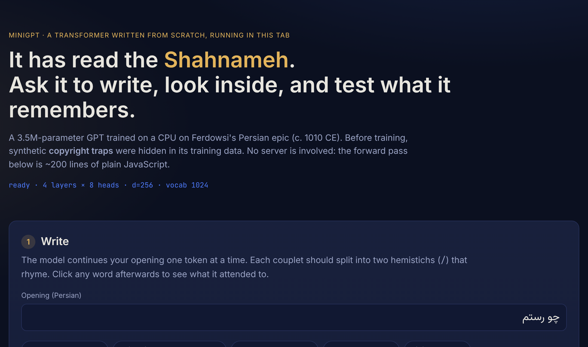
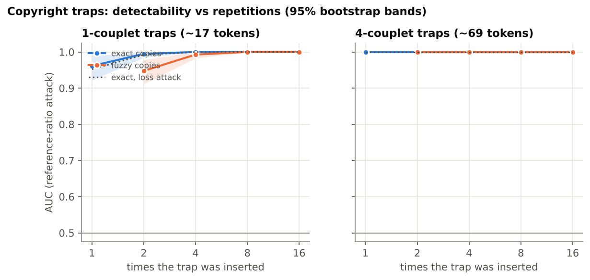

# MiniGPT · شاهنامه

**A GPT written from scratch, trained on Ferdowsi's *Shahnameh*, and then
attacked: can you tell what it was trained on?**

### ▶ [Live demo](https://aliyousefi9403.github.io/MiniGPT/): it writes Persian verse in your browser, shows where every attention head looks, and tests whether a text was in its training data.



## In plain English

Large language models are trained on huge piles of text scraped from the web,
and the people who wrote that text usually cannot find out whether their work
was used. This project builds a small language model completely from scratch,
the same kind of model as GPT, and then plays both sides of that question.

1. **The model.** A 3.5-million-parameter transformer trained on a laptop-class
   CPU (about 40 minutes) on the *Shahnameh*, the 50,000-couplet Persian national epic
   (c. 1010 CE). Every part is hand-written: the tokenizer, attention, the
   optimiser, the training loop, and a second copy of the model in plain
   JavaScript that runs in the browser. It learns to write lines in the
   epic's couplet form, and I found two attention heads whose job is to make
   the second half of a couplet rhyme with the first.
2. **The audit.** Before training I hid fake "copyright traps" in the training
   data: nonsense couplets planted 1 to 16 times, some copied exactly and some
   changed slightly each time. Then I attacked the trained model with five
   membership-inference attacks from the research literature to see which
   traps, and which real couplets, can be proven to have been in the training
   data, and *when during training* that becomes possible.

The privacy half is a small-scale replication of ideas from Imperial College's
Computational Privacy Group: *Copyright Traps for Large Language Models*
(Meeus et al., ICML 2024), *Mosaic Memory* (fuzzy duplicates) and *Did the
Neurons Read your Book?* (USENIX Security 2024).

## Headline results

All numbers are single-seed; details, confidence intervals and what did not work
are in [docs/RESULTS.md](docs/RESULTS.md).

| | result |
|---|---|
| Language modelling | **1.79 bits/char** on held-out text vs **2.13** for the best character n-gram |
| Verse form | 97% of generated lines are well-formed couplets; 12% rhyme on the last two letters (chance 3%, Ferdowsi 93%) |
| Rhyme heads | ablating head 3.7 raises loss on the rhyme word by **0.53 nats** but on other tokens by **0.007** |
| Membership of real couplets | reference-ratio attack: **AUC 0.94**, **41% TPR at 1% FPR**; blind baselines ≈ 0.5 |
| Copyright traps | in the fully trained model every trap is detectable, even one planted once (AUC 0.96); the training-dynamics experiment shows when this happens |
| Canaries | a 5-digit secret planted 4× ranks in the model's top 20 guesses out of 100,000; planted 16× it is the top guess |
| Whole sections | averaging over 8 couplets of a section gives AUC ≈ 1.0 |



## What's inside

```
minigpt/
  tokenizer.py        BPE from scratch (Persian-aware, digits never merged)
  model.py            GPT: causal attention, positional encodings, pre-norm blocks
  optim.py            AdamW + warm-up/cosine schedule (tested against PyTorch's)
  train.py            training loop, checkpoint selection, exact resume
  ngram.py            Witten-Bell character n-gram baselines
  verse.py            couplet / rhyme / copying metrics
  sae.py              sparse autoencoder for the residual stream
  privacy/
    traps.py          copyright traps (exact + fuzzy) and Secret-Sharer canaries
    attacks.py        loss, zlib, min-k%, min-k%++, reference-ratio
    metrics.py        AUC, ROC, TPR@FPR, bootstrap CIs (NumPy only)
web/                  the demo: index.html + a ~200-line JavaScript transformer
scripts/              every experiment, one script each (see run_all.sh)
tests/                37 unit tests + a JavaScript-vs-PyTorch parity test
docs/DESIGN.md        why every decision was made
docs/RESULTS.md       all numbers, honestly
```

## Reproduce

Everything runs on a CPU; times are for 4 cores.

```bash
pip install -r requirements.txt --extra-index-url https://download.pytorch.org/whl/cpu
pytest -q                     # 37 tests, ~1 min
scripts/run_all.sh            # everything below, ~4.5 hours
```

| step | script | time |
|---|---|---|
| split, tokenizer, traps | `scripts/prepare.py` | 10 s |
| target + reference models | `scripts/train_all.sh` | 2 × 40 min |
| training-dynamics run, 3 positional-encoding ablations | `scripts/train_all.sh` | 40 + 3 × 20 min |
| language-model evaluation | `scripts/evaluate_lm.py` | 2 min |
| membership inference | `scripts/run_mia.py`, `scripts/run_dynamics.py` | 5 + 10 min |
| attention analysis, SAE | `scripts/analyze_attention.py`, `scripts/train_sae.py`, `scripts/label_sae_features.py` | 2 + 5 + 2 min |
| figures, demo export | `scripts/make_figures.py`, `scripts/export_web.py` | 10 s |

The trained weights used by the demo are in `web/model/` (float16).

## Data

Ferdowsi's *Shahnameh* (public domain), Persian original, from the
[Ganjoor](https://ganjoor.net) digital library; see [data/README.md](data/README.md)
for provenance and why the original was chosen over an English translation.
