# Results

Every number below is produced by a script in `scripts/` and stored as JSON in
`results/`; figures are rendered from those files by `scripts/make_figures.py`.

**Read this first.** All models are trained once (seed 0). The confidence
intervals are 95% percentile-bootstrap intervals over the *evaluation* items
(members and non-members resampled separately, 500 resamples). They capture
how much an AUC would move with a different sample of test texts, **not** how
much it would move with a different training run. Where a result is near a
threshold, treat it as indicative.

- [1. The language model](#1-the-language-model)
- [2. Inside the model: rhyme heads and SAE features](#2-inside-the-model)
- [3. Membership inference](#3-membership-inference)
- [4. What did not work, and limitations](#4-what-did-not-work-and-limitations)

---

## Setup in numbers

| | A (target) | B (reference) | V (validation) | H (held out) |
|---|---|---|---|---|
| sections | 386 | 386 | 43 | 42 |
| couplets | 21,772 | 22,418 | 2,537 | 2,883 |
| tokens | 412,755 real + 135,551 inserted | 422,943 | 47,882 | 54,808 |

The tokenizer averages 2.84 characters per token. Traps and canaries make up
**24.7%** of the target's training tokens (§4 discusses the consequences).
Models: 4 layers, 8 heads, width 256, context 128, **3.45M parameters**,
4,000 steps of 32 × 128 tokens (≈ 30 epochs of the target corpus), best
checkpoint chosen on V. Training time on 4 CPU cores: ~36 min per model when
the machine is otherwise idle.

## 1. The language model

### 1.1 Prediction: bits per character on V

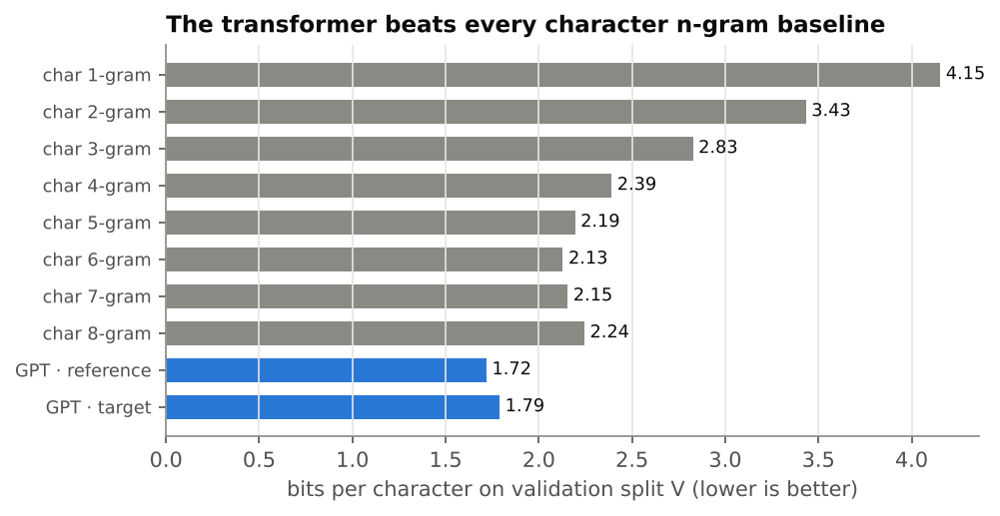

| model | bits / char |
|---|---|
| character 1-gram | 4.15 |
| character 3-gram | 2.83 |
| character 6-gram (best n-gram) | **2.13** |
| character 8-gram | 2.24 (more context, too little data: overfits) |
| GPT, reference (trained on B) | **1.72** |
| GPT, target (trained on A + traps) | **1.79** |

The transformer predicts unseen Shahnameh text 16% better than the best
n-gram. Bits per character are tokenizer-independent, so this is a like-for-like
comparison.

The target is 0.07 bits/char worse than the reference. Two causes are mixed
here and cannot be separated with one run each: (a) a quarter of the target's
training text is meaningless trap material, and (b) A and B are different
sections of the epic. The size of the gap is consistent with (a): the target
reached its best validation loss later (step 3,750 vs 2,250), as if the traps
were acting as a regulariser that also wastes capacity.

### 1.2 Verse form

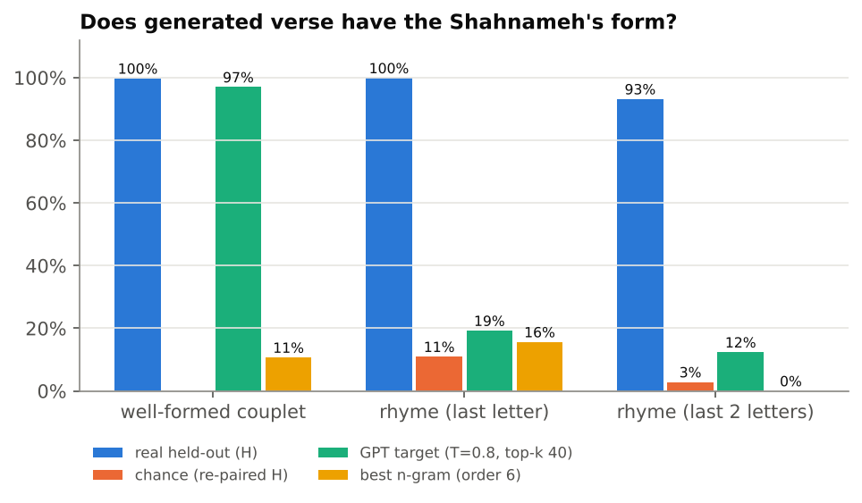

| | well-formed couplet | rhyme@1 | rhyme@2 | copies a training couplet |
|---|---|---|---|---|
| Ferdowsi (H) | 99.8% | 99.9% | 93.2% | 0.07% (formulaic repeats) |
| chance (H halves re-paired) | – | 10.9% | 2.8% | – |
| **GPT** (T = 0.8, top-k 40, 300 lines) | **97.0%** | **19.2%** | **12.4%** | **0%** |
| best n-gram (order 6) | 10.7% | 15.6% | 0.0% | 0% |

* The model has learned the couplet *shape* almost perfectly: two hemistichs of
  3–9 words around a caesura. The n-gram cannot, because the caesura is more
  than 6 characters away from anything that predicts it.
* It rhymes **4.4× more often than chance** on the two-letter criterion, which
  shows rhyme is being learned, but it is far from Ferdowsi's 93%. Getting the
  rhyme right means choosing a final word that both rhymes *and* fits the
  metre and sense, which is a lot to ask of 3.5M parameters.
* It does not regurgitate: none of 300 sampled lines is a training couplet,
  and 2.3% of its words are not in the training vocabulary (Ferdowsi's own
  held-out text has 3.6% words unseen in A, so this is in the natural range).

Sample output (unedited, first lines of `results/samples.json`):

```
نه هنگام پرسیم آمد بده / که افگندی اندر تگ
ببخشید سیصد شتروار بار / به پیش بردند نام اوی
بیاورد برزین چنین یال / چنین گفت پس شهریار
```

(“He granted three hundred camel-loads of goods / and carried his name before
them…”: the vocabulary and the formulae, e.g. *chonin goft pas shahriyar*,
“thus then spoke the king”, are the epic's; the sense drifts.)

### 1.3 Positional encodings

Same model and recipe, trained on the clean reference corpus for 2,000 steps
(`scripts/train_all.sh`, ~18 min each), one seed per variant:

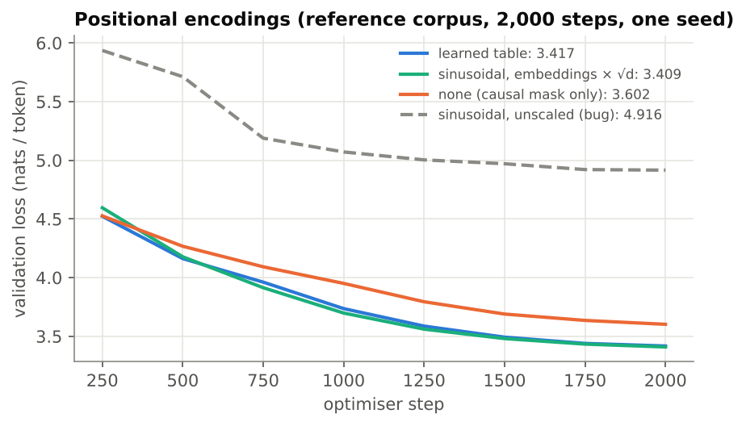

| positional information | best val loss | bits / char |
|---|---|---|
| learned table (used for all other models) | 3.417 | 1.719 |
| sinusoidal, token embeddings × √d | **3.409** | **1.717** |
| none: position only through the causal mask | 3.602 | 1.814 |
| sinusoidal, *without* embedding scaling (first attempt) | 4.916 | 2.492 |

* **Learned and sinusoidal tie** (difference 0.008 nats, well within what
  a different seed would change). I kept the learned table for the main
  models, the GPT-2 choice, because it needs no extra scaling convention.
* **No positional encoding works surprisingly well**, only 5.5% worse in
  bits per character. A causal model can infer position on its own, e.g. by
  how attention spreads over the visible prefix, which agrees with Haviv et
  al. (2022, "Transformer language models without positional encodings still
  learn positional information").
* **My first sinusoidal run was a bug, kept as a result.** Without the √d
  scaling of the original Transformer, each fixed table row has norm ≈ 11
  while a token embedding starts at ≈ 0.25. Position drowned out token
  identity by a factor of ~44, and the model never recovered within the
  budget (4.92, worse than no positions at all). It is a concrete
  illustration of why that "unexplained" √d factor is in Vaswani et al.

## 2. Inside the model

### 2.1 Two attention heads implement rhyme

To rhyme, the model must, while choosing the last word of a couplet, look
back at the last word of the first hemistich. `scripts/analyze_attention.py`
measures, over the 2,881 held-out couplets, how much of each head's attention
goes to that word.

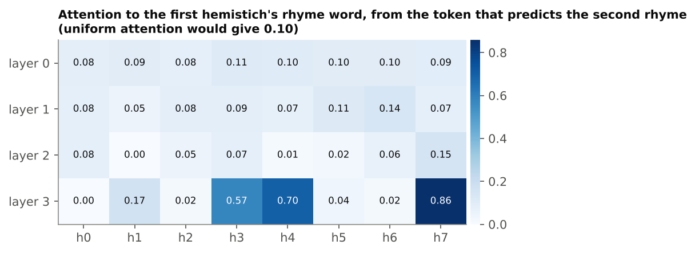

| head | from the token that predicts the rhyme | from the last token | mid-hemistich control | uniform baseline |
|---|---|---|---|---|
| **L3 h7** | **0.86** | 0.92 | 0.47 | ≈ 0.10 |
| **L3 h4** | **0.70** | 0.62 | 0.26 | ≈ 0.10 |
| L3 h3 | 0.57 | 0.28 | 0.46 | ≈ 0.10 |

The control column matters: L3 h3 looks at the end of the first hemistich
from everywhere, so it is a "where is the caesura" head, while h7 and h4 look
there much more sharply when the rhyme is due.

**Causal test.** Attention patterns show where a head looks, not that the
model depends on it. Zero-ablating one head at a time:

| ablated head | Δ loss on the rhyme token | Δ loss on all other tokens | ratio |
|---|---|---|---|
| **L3 h7** | **+0.534 nats** | +0.007 | 76× |
| **L3 h4** | **+0.460** | +0.010 | 46× |
| L1 h0 | +0.156 | +0.015 | 10× |
| L3 h3 | +0.132 | +0.003 | 44× |
| (all other 28 heads) | < +0.10 | | |

Baseline loss on rhyme tokens is 3.15 nats. Removing h7 alone makes the rhyme
word ~1.7× less likely on average while leaving the rest of the text
essentially untouched. This is the cleanest mechanistic finding in the project.

### 2.2 Sparse autoencoder

An SAE with 2,048 features was trained on the residual stream after layer 1
(412,672 token activations, `scripts/train_sae.py`).

| | |
|---|---|
| mean active features per token (L0) | 10.1 |
| variance explained (held-out activations) | 86.5% |
| next-token loss: clean / SAE spliced in / layer mean-ablated | 2.42 / 3.27 / 6.94 |
| share of loss gap recovered | 81% |
| dead features / features active on > 10% of tokens | 0 / 8 |
| features whose top-6 activations are all one token | 1,718 (84%) |

So the SAE is a reasonable but lossy description of this layer: splicing it in
costs 0.85 nats, i.e. 19% of what deleting the layer's information costs.

**Labelling features, tested rather than eyeballed** (`scripts/label_sae_features.py`).
For six categories every token was marked in or out, and the best single
feature (as a binary detector, active > 0) was found by F1 over all 412k tokens:

| category | base rate | best feature | precision | recall | what it actually detects |
|---|---|---|---|---|---|
| royalty (shah, throne, crown) | 1.1% | 678 | 0.84 | 0.33 | the word شاه *shah* |
| battle (war, army, mace, …) | 1.3% | 229 | 0.89 | 0.15 | the word سپاه *sepah*, army |
| hero names | 1.0% | 1985 | 0.85 | 0.09 | the name رستم *Rostam* |
| God | 0.25% | 1036 | 0.85 | 0.35 | the word یزدان *Yazdan* |
| end of first hemistich | 5.3% | 1978 | 0.69 | 0.38 | **many different words** at the caesura |
| end of line (rhyme slot) | 5.3% | 1062 | 0.62 | 0.36 | **many different words** at line end |

The honest reading: the "king", "battle" and "Rostam" features are **single-word
detectors**, not abstract concepts; several categories are split across
features that each own one word (e.g. two features both fire on *shah*). The
features that are genuinely abstract are **structural**: they fire on whatever
word sits at the end of a hemistich, at 12–13× the base rate. At this model
size and depth, what the residual stream represents abstractly is the *form*
of the verse, which agrees with the rhyme-head finding above.

## 3. Membership inference

### 3.1 Real couplets: was this line in the training data?

3,000 random couplets from A (members) vs all 2,881 couplets of H
(non-members; 2 held-out couplets that also occur verbatim in A were removed:
Ferdowsi repeats formulae, and 3.0% of held-out *hemistichs* also occur in A).

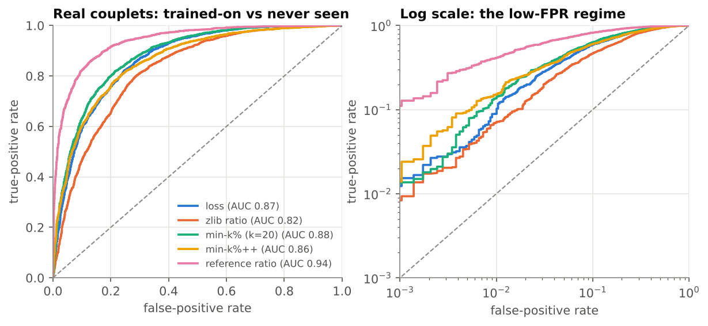

| attack | AUC [95% CI] | TPR @ 1% FPR | TPR @ 10% FPR |
|---|---|---|---|
| loss | 0.866 [0.857, 0.874] | 8.9% | 59.1% |
| zlib ratio | 0.822 [0.812, 0.832] | 7.0% | 46.6% |
| min-k% (k = 20%) | 0.880 [0.871, 0.888] | 13.6% | 63.2% |
| min-k%++ | 0.860 [0.850, 0.870] | 15.1% | 60.1% |
| **reference ratio** | **0.938 [0.932, 0.943]** | **41.0%** | **82.2%** |

**Blind baselines (no model involved)**, which test whether members and
non-members differ in distribution:

| blind score | AUC |
|---|---|
| couplet length | 0.504 |
| zlib compressibility of the text | 0.494 |
| reference-model loss (it saw neither A nor H) | 0.506 |
| bag-of-words naive Bayes, folds grouped by section | 0.512 |

All ≈ 0.5, so the attacks are measuring memorisation, not a difference between
the two sets of text. (A first version of the bag-of-words baseline scored
0.585 because its cross-validation folds put couplets of the same section on
both sides, so it learned to recognise sections; see §4.)

Why so strong compared with LLM papers, where MIAs on real text are often
near chance? Because this model has seen each training couplet ~28 times and
its training loss (1.98) is far below its validation loss (3.54): this is the
heavily-memorising regime. §3.5 shows how the AUC grows during training.

### 3.2 Whole documents

"Did the Neurons Read your Book?" argues that membership is far easier to
detect for a whole document than for one sentence. Averaging couplet scores
over *k* random couplets of a section (42 member sections vs the 42 H
sections, 20 random draws per k):

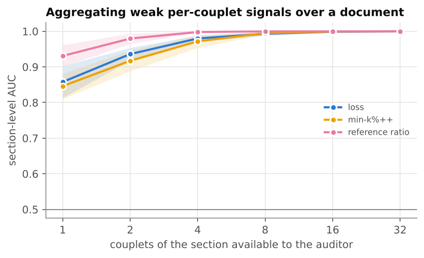

| couplets per section | 1 | 2 | 4 | 8 | 16 | 32 |
|---|---|---|---|---|---|---|
| loss | 0.86 | 0.94 | 0.98 | 0.99 | 1.00 | 1.00 |
| min-k%++ | 0.85 | 0.92 | 0.97 | 1.00 | 1.00 | 1.00 |
| reference ratio | 0.93 | 0.98 | 1.00 | 1.00 | 1.00 | 1.00 |

Four couplets are enough for near-certainty. With 42 + 42 sections these AUCs
have wide intervals; what is robust is the steep rise with k.

### 3.3 Copyright traps in the final model

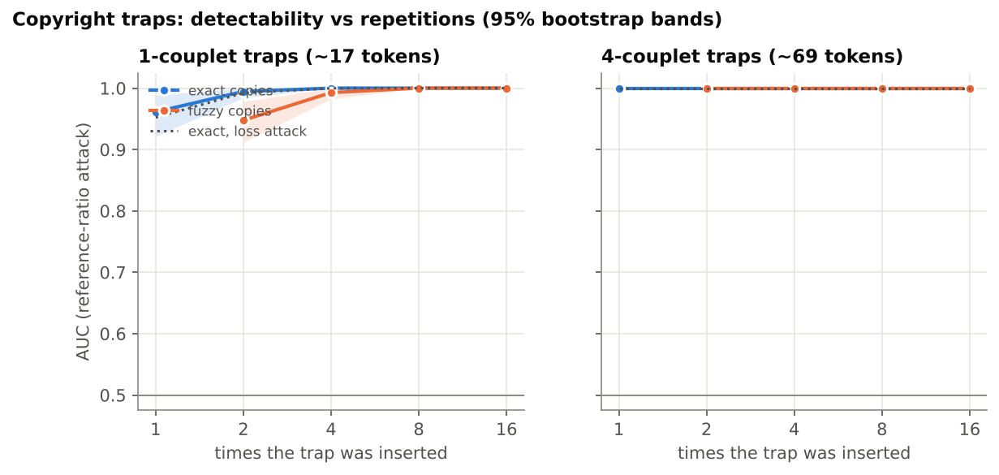
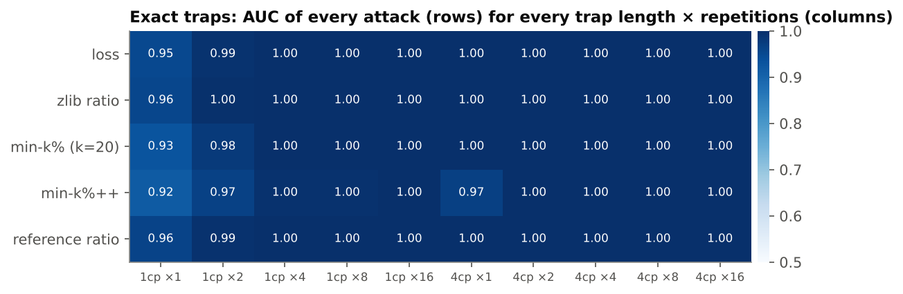

In the fully trained target, **every trap cell is detectable**:

| trap | ×1 | ×2 | ×4 | ×8 | ×16 |
|---|---|---|---|---|---|
| 1 couplet, exact | 0.96 | 0.99 | 1.00 | 1.00 | 1.00 |
| 1 couplet, fuzzy | – | 0.95 | 0.99 | 1.00 | 1.00 |
| 4 couplets, exact | 1.00 | 1.00 | 1.00 | 1.00 | 1.00 |
| 4 couplets, fuzzy | – | 1.00 | 1.00 | 1.00 | 1.00 |

(reference-ratio attack, AUC vs 160 never-planted traps of the same length;
24 traps per cell.)

Three observations survive the saturation:

1. **Longer traps are easier.** At one insertion, 4-couplet traps are perfectly
   detected (AUC 1.00, TPR@1% = 100%) while 1-couplet traps are not (0.96,
   TPR@1% = 62%). This matches Meeus et al.: length helps.
2. **Fuzzy duplicates still leak.** A 1-couplet trap planted twice with 20% of
   its words changed in *each* copy, so the original text was never seen even
   once, is detected with AUC 0.95, almost as well as two exact copies (0.99).
   This is the "mosaic memory" effect: near-duplicate deduplication would not
   have protected it.
3. **The reference ratio is the strongest attack**, and its lead is largest
   exactly where the signal is weak (1-couplet fuzzy ×2: ratio 0.95 vs loss
   0.86 vs min-k%++ 0.82).

The original paper's headline, that short traps need hundreds of repetitions,
is **not** reproduced here, and should not be: that paper trained for about one
pass over the data, while this model saw each trap ~28 times *per insertion*.
§3.5 is the experiment that makes the two comparable.

### 3.4 Secret-Sharer canaries

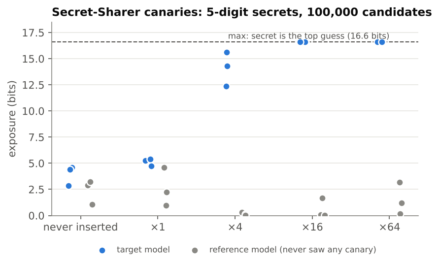

Exposure = log₂(100,000) − log₂(rank of the true 5-digit secret), computed
exactly over all 100,000 candidates. Maximum 16.6 bits; chance ≈ 1.4.

| planted | exposure in the target (3 canaries) | in the reference |
|---|---|---|
| 0 (control) | 4.6, 4.4, 2.9 | 2.9, 1.1, 3.2 |
| 1 | 5.3, 5.4, 4.7 | 1.0, 2.2, 4.6 |
| **4** | **15.6, 14.3, 12.4** | 0.3, 0.1, 0.0 |
| 16 | 16.6, 16.6, 16.6 | |
| 64 | 16.6, 16.6, 16.6 | |

Planted 4 times (≈ 110 exposures counting epochs), a secret becomes one of the
model's top ~20 guesses out of 100,000; at 16 it is the top guess. Note the
controls: never-planted secrets have exposure ≈ 4 in the target vs ≈ 2 in the
reference. The target has learned that this template is followed by Persian
digits with a particular digit distribution, which lifts *all* plausible
secrets a little. Exposure should be compared with these controls, not with
the theoretical chance level.

### 3.5 When does memorisation appear? (training dynamics)

The final model has seen every training token ~28 times, which is why every
trap is detectable there. Real LLMs see their data about once. To connect the
two regimes, the target recipe was run again with weight snapshots at
0.5, 1, 2, 4, 8, 16 and 28 epochs, and every snapshot was attacked
(`scripts/run_dynamics.py`; the re-run reproduces the target's loss curve to
four decimals, so the snapshots belong to the very model attacked above).

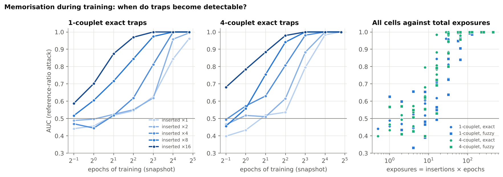
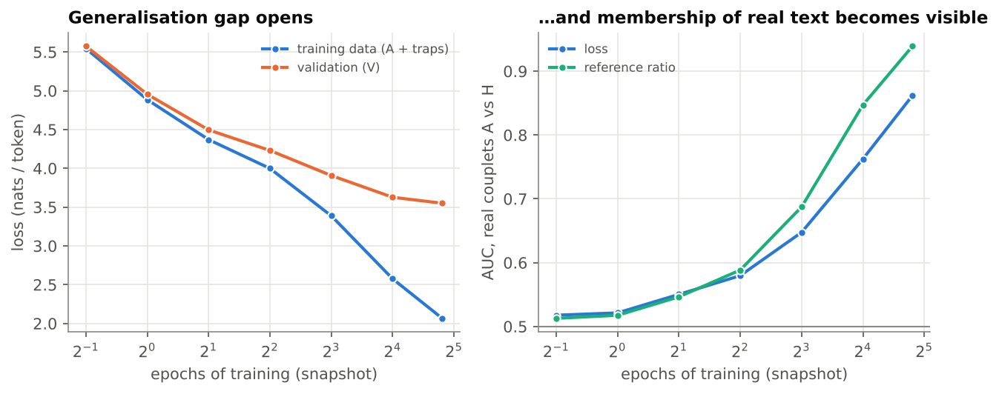

Reference-ratio AUC per snapshot (24 members vs 160 controls per trap cell;
an AUC within ~0.12 of 0.5 is not distinguishable from chance at this sample size):

| epochs | val / train loss | real couplets | 1-couplet ×1 | ×4 | ×16 | 4-couplet ×1 | ×4 | ×16 | 1-couplet fuzzy ×16 |
|---|---|---|---|---|---|---|---|---|---|
| 0.5 | 5.58 / 5.54 | 0.51 | 0.44 | 0.47 | 0.59 | 0.40 | 0.49 | 0.68 | 0.47 |
| **1** | 4.96 / 4.89 | **0.52** | 0.46 | 0.45 | **0.70** | 0.43 | 0.57 | **0.78** | 0.57 |
| 2 | 4.50 / 4.37 | 0.55 | 0.52 | 0.52 | 0.87 | 0.52 | 0.63 | 0.88 | 0.73 |
| 4 | 4.23 / 4.00 | 0.59 | 0.54 | 0.62 | 0.97 | 0.54 | 0.81 | 0.98 | 0.91 |
| 8 | 3.91 / 3.39 | 0.69 | 0.63 | 0.81 | 1.00 | 0.80 | 0.98 | 1.00 | 0.99 |
| 16 | 3.63 / 2.58 | 0.85 | 0.84 | 1.00 | 1.00 | 0.98 | 1.00 | 1.00 | 1.00 |
| 28 | 3.55 / 2.07 | 0.94 | 0.96 | 1.00 | 1.00 | 1.00 | 1.00 | 1.00 | 1.00 |

What this shows:

1. **After one epoch, the regime of real LLMs, real text is not detectably
   memorised** (AUC 0.52), and neither are traps inserted up to 4 times. Only
   traps repeated 16 times are detectable (0.70 for 1 couplet, 0.78 for 4).
   Qualitatively this is the copyright-traps paper's finding at a scale of
   3.5M parameters: short traps need many repetitions, and longer traps are
   detected earlier.
2. **Membership of real text tracks the generalisation gap.** The real-couplet
   AUC stays near 0.5 while training and validation loss are close and rises
   with the gap (0.59 at a gap of 0.23 nats, 0.94 at 1.48).
3. **Exposures are the main driver, but not the only one** (right panel).
   Plotted against insertions × epochs, the cells line up roughly: AUC rises
   from chance below ~8 exposures to ~1 above ~30. But the same 16 exposures
   give 0.70 when they all happen within the first epoch (×16 at epoch 1) and
   0.84 when spread over 16 epochs (×1 at epoch 16). Spaced repetition
   memorises more, or a more-trained model memorises more per exposure. One run
   cannot separate the two.
4. **Fuzzy traps lag exact ones early and catch up later** (1-couplet ×16:
   0.57 vs 0.70 at epoch 1, 0.91 vs 0.97 at epoch 4, both ≈1 from epoch 8).
5. **Canaries need few exposures.** Planted 64 times, two of three secrets
   already have exposure ≥ 14 bits (rank ≤ 6 of 100,000) after a single epoch;
   planted 16 times they need ~16 epochs (≈ 256 exposures) to reach the
   top. A fixed, low-entropy template followed by a secret is memorised much
   faster than a 17-token nonsense couplet.


## 4. What did not work, and limitations

* **The trap experiment saturated.** I designed the trap grid (1–16
  insertions) with the paper's one-epoch setting in mind and then trained for
  30 epochs, which multiplies every repetition by ~28. Every cell came out
  near AUC 1. Rather than shrink the training to make the plot look like the
  paper's, I added the training-dynamics experiment (§3.5), which shows the
  whole transition. The snapshots are points on one training trajectory: an
  early snapshot has not had its learning rate decayed, so it is not identical
  to a model trained to convergence for that many epochs.
* **Trap style leaks.** Because 25% of the target's training data is trap text,
  the target learned the trap generator's *style*: never-planted traps are
  also easier for the target than for the reference. Compared against
  thresholds calibrated on real couplets, even an unplanted trap looks like a
  member. The AUC experiments compare planted vs unplanted traps and are not
  affected, but the demo has to calibrate traps against unplanted traps. In
  a real corpus traps would be a negligible fraction and this effect would
  vanish; it is an artefact of scale worth knowing about.
* **Bugs found and fixed along the way.** (1) The first tokenizer had no digits
  in its alphabet (the Shahnameh contains none), so every canary secret
  encoded to the same `<unk>` tokens; both models were retrained after the
  fix. (2) The bag-of-words blind baseline originally scored 0.585 because of
  section leakage across folds; it now uses section-grouped folds (0.512).
  (3) An early version of the demo flagged a never-planted trap as a member
  (see the previous point). (4) The sinusoidal positional encoding was first
  added without scaling the embeddings, which wrecked that ablation (§1.3).
* **The perplexity analysis (E5) is uninformative.** Splitting traps by their
  reference-model perplexity, as Meeus et al. do, gives AUC 1.0 in every
  tercile because of saturation.
* **One seed, one split.** A second seed would cost another ~80 minutes per
  model pair on CPU. The rhyme-head result is the one I would most like to
  replicate across seeds: whether *which* heads become rhyme heads is stable is
  an open question here.
* **Rhyme is approximated in writing.** Persian script omits short vowels, so
  rhyme@k compares written letters. It under-counts true rhymes whose vowels
  differ in writing and over-counts eye-rhymes. The same metric is applied to
  Ferdowsi's text (93%), the model and chance, so comparisons are fair even
  though the absolute values are approximate.
* **The reference model is not an ideal reference.** It is trained on a
  different half of the epic, so stories in A that have no counterpart in B
  are unusual for the reference too. A LiRA-style attack with many shadow
  models would be stronger and better calibrated; it is out of reach on CPU.
* **No defence was evaluated.** Deduplication would not have helped against the
  fuzzy traps (§3.3); DP-SGD would, at a cost in quality, and is the natural
  next experiment.
